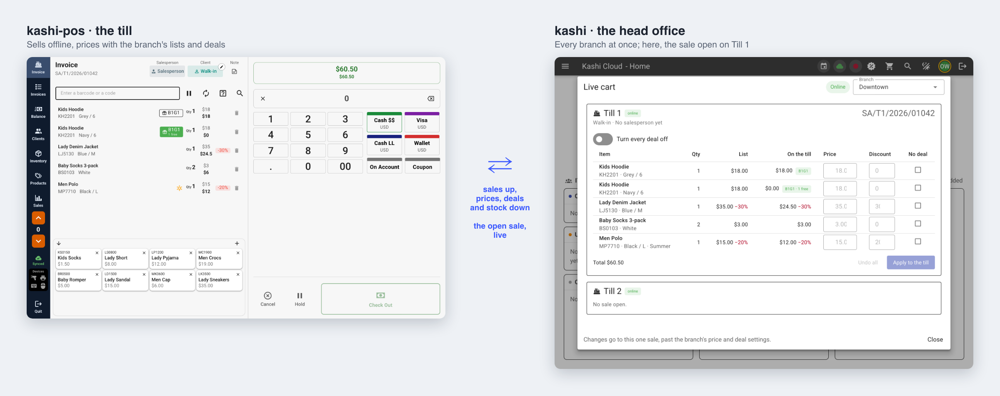

# kashi-pos

The till app for each branch of a shop running [Kashi](https://github.com/mhdna/kashi).
It sells offline from its own SQLite database, prices every sale with the branch's
price and discount lists and deals, and syncs with Kashi whenever it's online:
sales go up, and products, prices, deals and stock come down.

<p align="center">
  
</p>
<p align="center"><sub>A sale being rung up on the till (left), seen live from Kashi (right), which can reprice it. Demo data.</sub></p>

## About

Built with Wails (Go) and Vue.

You can configure the project by editing `wails.json`. More information about the project settings can be found
here: https://wails.io/docs/reference/project-config

## Live Development

To run in live development mode, run `wails dev` in the project directory. This will run a Vite development
server that will provide very fast hot reload of your frontend changes. If you want to develop in a browser
and have access to your Go methods, there is also a dev server that runs on http://localhost:34115. Connect
to this in your browser, and you can call your Go code from devtools.

## Building

To build a redistributable, production mode package, use `wails build`.

## Embedded remote admin API

The POS can optionally expose the admin API from the same process that owns the SQLite database. This avoids running a separate database agent on the POS device. Set these environment variables before launching the app:

```sh
export KASHI_ADMIN_ENABLED=1
export KASHI_ADMIN_LISTEN=0.0.0.0:8787
export KASHI_ADMIN_TOKEN='choose-a-secret'
```

Use `127.0.0.1:8787` (the default) for local-only access. A token is required for non-loopback listeners. The existing TUI client in `tools/kashi-admin` can connect with `--server` and `--token`. Its reload action emits an app event that refreshes the running frontend.
